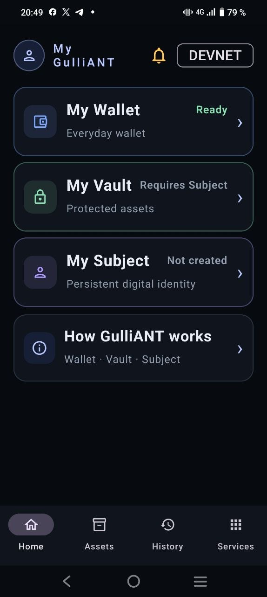
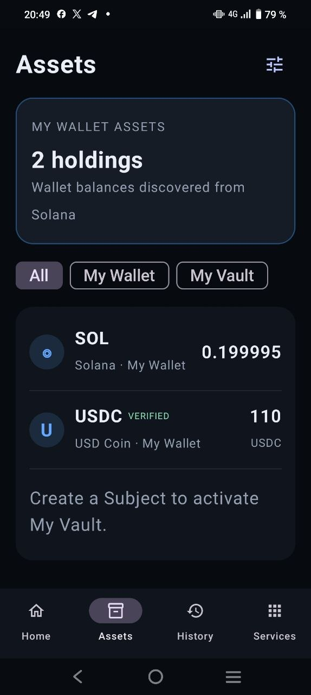
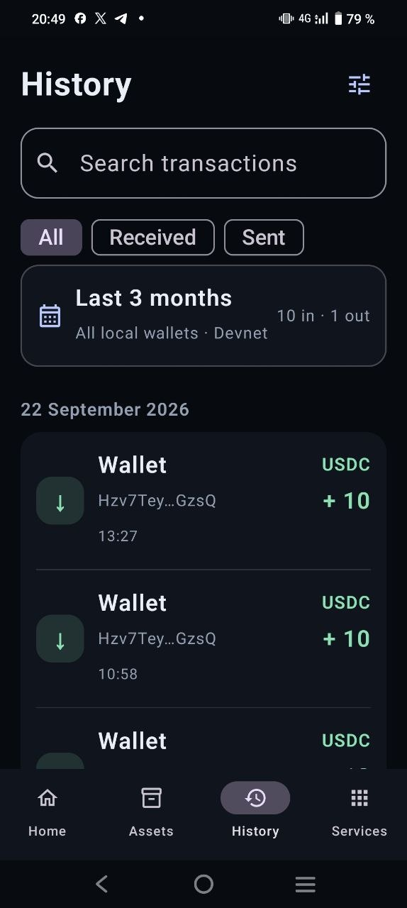
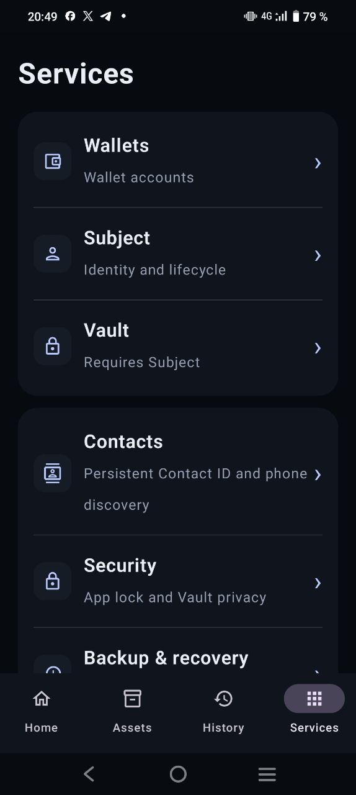

# GulliANT Wallet — Android (Solana Devnet)

**GulliANT Wallet** is an Android application for exploring wallet accounts, a persistent protocol **Subject**, and Subject-dependent Vault functionality on **Solana Devnet**.

This repository distributes a **signed Android release APK** and screenshots. It is **not** the source-code repository for GulliANT Subject Protocol.

> **Devnet demonstration.** Use test accounts and test assets only. Do not import a production recovery phrase or use real funds. Features and integrations may change during development.

## Download and install

**Android APK:** [`GulliANT-Wallet-Release.apk`](./GulliANT-Wallet-Release.apk)

1. Open the APK link above and select **Download raw file** (or the GitHub download option).
2. Transfer the downloaded APK to an Android device, if necessary.
3. Open the APK on the device and approve installation from that source when Android prompts you.
4. Launch **GulliANT Wallet**. The app currently targets **Solana Devnet**.

**Android requirement:** Android 9 (API 28) or newer. This APK is signed with the GulliANT release certificate. If a debug build with the same package name is already installed, Android may require uninstalling it before installing this release; **back up any wallet recovery material before uninstalling** because local app data can be lost.

## Screenshots

| Home | Assets |
| --- | --- |
|  |  |

| History | Services |
| --- | --- |
|  |  |

## What you can explore

- **Wallet:** Wallet accounts and balances on Solana Devnet.
- **Subject:** A persistent protocol Subject distinct from a replaceable wallet/controller, designed to provide continuity beyond an individual wallet address.
- **Vault:** Subject-dependent protected-asset experience.
- **Assets and History:** Wallet holdings and transaction history.
- **Services:** Navigation to Wallets, Subject, Vault, Contacts, Security, and Backup & recovery.

Some screens or operations may require a configured wallet, a Subject, network connectivity, or additional setup. Screenshots illustrate a test environment and do not guarantee identical balances on a new installation.

## Related links

- **GulliANT:** https://gulliant.com/
- **Subject experience:** https://gulliant.com/subject/

## Release information

- **Application ID:** `com.gulliant.wallet`
- **App version:** `0.6.18.26-message-delivery-state` (`versionCode` 99)
- **Network:** Solana Devnet
- **Build:** Android release build, optimized and minified with R8
- **Distribution:** Signed APK in this repository

### Signing certificate (SHA-256)

```text
71d76bc3166cec891cddd41b554aa8c48ee14748a42e1b6ae002ac531f97546d
```

The fingerprint identifies the public signing certificate; it is not a secret. Download APKs only from an official GulliANT distribution link.

## Development and licensing

GulliANT Subject Protocol is **proprietary**, not open source. Availability of this APK and screenshots does not grant permission to reuse, redistribute, reverse-engineer, or modify proprietary GulliANT components beyond rights granted by applicable law or a separate agreement.

The Android app and its integrations remain under active development. This repository is intended for **APK distribution and demonstration**, not as a source-code release.
